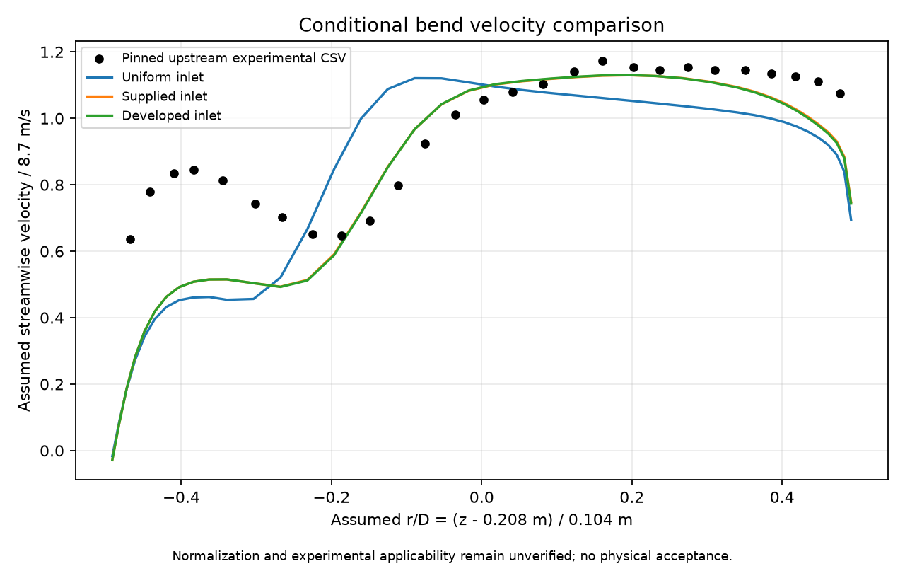
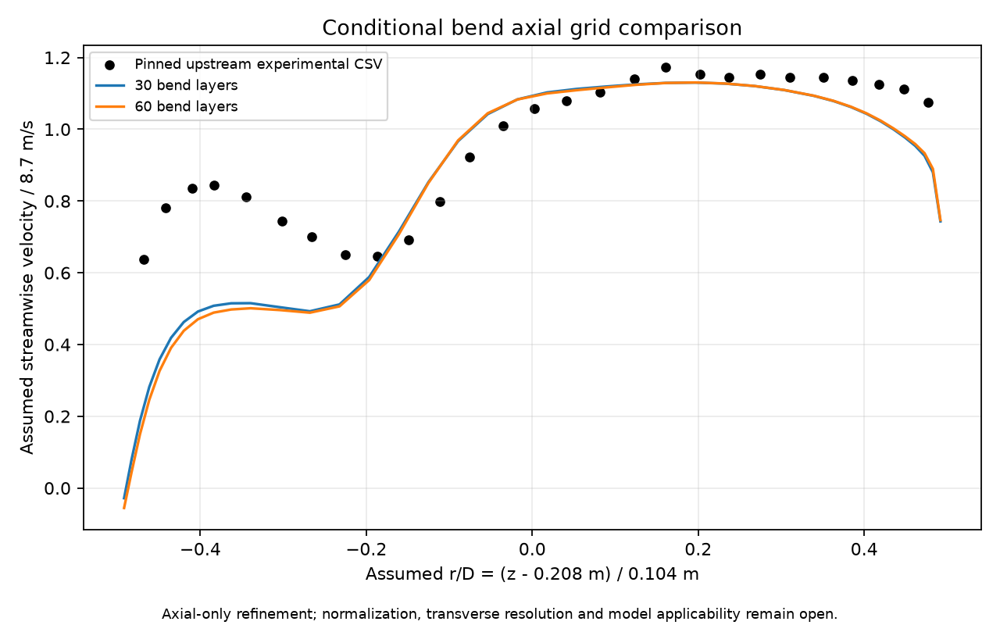

# Developed-inlet bend check

The original pinned upstream bend has now run with the numerically verified developed inlet. SU2 8.6.0 exits normally at iteration 498 with all six logRMS residuals <= -10. Existing `bsa.cfd_convergence` checks the complete last 200 iterations (299–498): signed inlet/outlet flow and mass targets pass, and total-pressure difference is stable. Mean complete-domain difference is 21.57356824 Pa with relative range 3.6538e-5. This includes the benchmark straight sections, not an isolated bend coefficient or project loss.

Existing `bsa.cfd_native_probe` binds all 75396 saved mesh points and extracts the same 40 native diameter nodes without interpolation. A separate conditional comparison interpolates these 40 values to all 27 pinned upstream CSV abscissae, without extrapolation. Assumed coordinates remain r/D=(z-0.208)/0.104 and velocity=global Ux/8.7. The original experimental full text, normalization and measurement uncertainty remain unverified.

Conditional normalized RMSE is 0.17817964 for the developed inlet, versus 0.17774048 for the supplied inlet and 0.22653723 for the uniform inlet. The developed and supplied curves nearly coincide; the inner-side discrepancy remains. The tested inlet-development change therefore did not resolve this discrepancy under the stated assumptions. These cases have different integrated flows, so this is not a fixed-flow shape-only sensitivity. No statistical agreement threshold or accepted physical error is invented.

[Executed evidence](evidence/developed-bend-check.json) pins the native field, mesh, probe method, numerical-window method and experimental CSV. The actual rendered figure was inspected. Raw mesh/field/profile and private run records remain local.

Reuse: SU2 commit 7048fd35f56d4bf52e586429d6746a36a10255f8 and official Tutorials commit ce41729be812da70f06bea0fd1a97a6ce4da14aa, LGPL-2.1; existing native probe and convergence adapters; NumPy 2.5.4 and Matplotlib 3.11.2. The experimental CSV is attributed to the pinned Sudo bend tutorial. Original experiment: Sudo, Sumida and Hibara (1998), DOI https://doi.org/10.1007/s003480050206 . No new engine, dependency or MCP is added.

Numerical convergence does not establish experimental agreement, turbulence validity, mesh independence or applicability to rough installed project ducts and lined plenums. The next physical verification must distinguish source-normalization, mesh and model effects rather than repeat inlet development. All 80 plenum and four compound-main project numerical losses per flow case remain missing; full fan duty and course delivery acceptance remain pending.

## Axial grid follow-up

A second actual mesh changes only the pinned geometry recipe's active Nbend from 30 to 60. Gmsh 4.15.2 produces 87278 positive-quality hexahedra and 93936 points. Complete exterior incidence and all eight marker orientations pass. The same 618 inlet points correspond one-to-one with maximum coordinate difference 1.323e-11 m (explicit geometric threshold 1e-9 m); this is not zero difference. Solver matching tolerance is unchanged. Original inlet numerical values are unchanged, with native flux 0.04375608945882391 kg/s. Existing SciPy nearest-node transfer initializes the new interior only; it is nonconservative and is not the final result.

The actual refined solve exits normally at iteration 431, all six logRMS <= -10. Existing convergence CLI passes the separate final 232–431 window and the native probe binds all 93936 points and extracts the same 40-node line. Whole-domain pressure changes from 21.57356824 to 21.58671457 Pa, approximately 0.06094 percent. Conditional normalized RMSE changes from 0.17818 to 0.18797; maximum native normalized curve change is 0.03761. Small pressure change cannot certify velocity convergence, transverse resolution, physical agreement or complete grid independence. The source dimensions and physical model were preserved; faceted geometry approximation changes with refinement.

[Executed axial-grid evidence](evidence/bend-axial-grid.json) records the actual mesh, native inlet flux, initialization limitation, terminal checks and conditional comparison. Figure rendering was inspected. Gmsh 4.15.2 (GPL-2.0-or-later), existing SciPy 1.18.1 and the same pinned SU2/Tutorials are reused; no new engine or adapter API is claimed. The current result does not resolve the inner-side curve discrepancy. Transverse-grid, model and original experiment definitions remain separate checks, and all project pressure gaps remain open.
